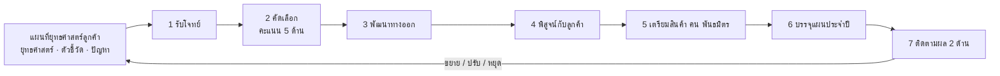

# กลไกเชื่อมยุทธศาสตร์ลูกค้ากับแผนธุรกิจกลุ่ม 3–5 ปี

> ต่อจาก [07 — ชื่อแทนรหัส และเส้นทางเหตุผล](07-plain-language-and-reasoning-chain.md)
> เอกสารนี้เป็นแบบโครงสร้าง (design) ทั่วไป ไม่มีข้อมูลกลยุทธ์จริงขององค์กร ข้อมูลจริงอยู่ใน Strategy Cockpit (private)

## 1. ทำไมต้องมีกลไกระดับกลุ่ม

กลุ่มบริษัทที่ขายให้ลูกค้ารัฐวิสาหกิจรายใหญ่ (เช่น การไฟฟ้า) มักเจอปัญหาเดียวกัน

| อาการ | ผลที่ตามมา |
|---|---|
| หลายบริษัทในกลุ่มเข้าหาลูกค้ารายเดียวกันแยกกัน | ลูกค้าเห็นผู้ขายหลายราย ไม่เห็นพันธมิตรรายเดียว · ข้อมูลปัญหาของลูกค้ากระจัดกระจาย |
| แผนธุรกิจตั้งจากยอดขายปีก่อน | ไม่ได้ตั้งจากสิ่งที่ลูกค้าต้องทำให้สำเร็จ จึงรู้ตัวช้าเมื่อลูกค้าเปลี่ยนทิศ |
| ขายเมื่อมี TOR | แข่งราคาเมื่อสเปกถูกเขียนไปแล้ว ไม่ได้ช่วยลูกค้ากำหนดโจทย์ตั้งแต่ต้น |
| วัดผลเฉพาะยอดขายของเรา | ไม่รู้ว่าลูกค้าได้อะไรจริง จึงขยับขึ้นบันไดความภักดี (Ladder of Loyalty) ไม่ได้ |

ลูกค้ารัฐวิสาหกิจมี **แผนวิสาหกิจ** และถูก **สคร. (สำนักงานคณะกรรมการนโยบายรัฐวิสาหกิจ)** ประเมินผลด้วยตัวชี้วัดทุกปี
ถ้ากลุ่มช่วยให้ตัวชี้วัดและปัญหาของลูกค้าดีขึ้นได้จริง และพิสูจน์ได้ด้วยหลักฐาน กลุ่มจะเปลี่ยนจากผู้ขายเป็นพันธมิตรของลูกค้า

### ลูกค้ารัฐวิสาหกิจถูกประเมินอย่างไร (SE-AM)

สคร. ประเมินรัฐวิสาหกิจทุกปีด้วยระบบ **SE-AM (State Enterprise Assessment Model)** ซึ่งใช้ตั้งแต่ปีประเมิน 2563 และปรับหลักเกณฑ์รายปี

| ส่วน | น้ำหนัก | ประเมินอะไร |
|---|---|---|
| ผลการดำเนินงาน (Key Performance Area) | 60% ± 15 | การดำเนินงานตามยุทธศาสตร์ (ยุทธศาสตร์ชาติ นโยบายรัฐ แผนวิสาหกิจ) และผลสำคัญด้านการเงินและไม่ใช่การเงิน · ตัวชี้วัดและเป้ารายปีอยู่ใน **บันทึกข้อตกลง (Performance Agreement)** ที่คณะอนุกรรมการรายสาขา (SubPAC) กำหนด |
| Core Business Enablers | 40% ± 15 | 8 ด้าน: การกำกับดูแลและการนำองค์กร · การวางแผนเชิงยุทธศาสตร์ · ความเสี่ยงและการควบคุมภายใน · ผู้มีส่วนได้ส่วนเสียและลูกค้า · เทคโนโลยีดิจิทัล · ทุนมนุษย์ · ความรู้และนวัตกรรม · การตรวจสอบภายใน |

คะแนนรวม 1–5 ผูกกับโบนัสของกรรมการและพนักงาน ผู้บริหารของลูกค้าจึงให้ความสำคัญกับตัวชี้วัดเหล่านี้มาก

สิ่งที่ผู้ขายควรทำ
- ผูกโจทย์กับตัวชี้วัดในบันทึกข้อตกลงของลูกค้า (เช่น ความเชื่อถือได้ของระบบไฟฟ้า) ก่อนตัวชี้วัดอื่น
- เสนอทางออกพร้อมตัวเลขผลลัพธ์ที่ลูกค้านำไปนับในตัวชี้วัดได้
- ร่วมพัฒนานวัตกรรมกับลูกค้า เพราะด้านความรู้และนวัตกรรมเป็นหนึ่งใน Enablers ที่ถูกประเมิน
- ส่งมอบตรงเวลาและเอกสารเบิกจ่ายครบ ช่วยให้ลูกค้าเบิกจ่ายงบลงทุนได้ตามเป้า
- ส่งรายงานผลลัพธ์ให้ลูกค้าก่อนรอบตรวจประเมินของปีถัดไป

> ข้อมูลจากหน้าเว็บ สคร. ในเอกสารนี้มาจากสรุปผลค้นหา ควรยืนยันกับ [หน้าระบบประเมินผลของ สคร.](https://www.sepo.go.th/evaluation/content/38) ก่อนใช้ทางการ

## 2. หลักการ

1. **เริ่มที่โจทย์ของลูกค้า จบที่ผลลัพธ์ของทั้งสองฝ่าย** — ทุกโจทย์ต้องผูกกับยุทธศาสตร์ ตัวชี้วัด หรือปัญหาที่ลูกค้าระบุเอง และวัดผลทั้งฝั่งลูกค้าและฝั่งกลุ่ม
2. **หลักฐานก่อนงบ** — โอกาสจะเข้าแผนประจำปีได้เมื่อมีหลักฐานจากลูกค้ารองรับ ไม่ใช่จากความเชื่อของทีมขาย
3. **ทำงานเป็นกลุ่มเดียว** — ทีมรายลูกค้ารวมคนจากทุกบริษัทที่เกี่ยวข้อง ลูกค้าเห็นหน้าเดียว
4. **คนตัดสิน AI ช่วย** — AI รวบรวมข้อมูล เสนอโจทย์ และตรวจเงื่อนไข · เวทีของคนเป็นผู้ตัดสินให้ผ่านแต่ละขั้น และบันทึกเหตุผล

## 3. องค์ประกอบ

### 3.1 แผนที่ยุทธศาสตร์ลูกค้า

ต่อลูกค้าหนึ่งราย เก็บ 5 เรื่อง พร้อมที่มาทุกรายการ

| เรื่อง | ตัวอย่างแหล่ง |
|---|---|
| ยุทธศาสตร์และโครงการตามแผนวิสาหกิจ | แผนวิสาหกิจ รายงานประจำปี |
| ตัวชี้วัด — ทั้งตัวที่ สคร. ใช้ประเมิน และตัวในแผนขององค์กร | รายงานผลการประเมิน รายงานประจำปี |
| ปัญหาและความท้าทายที่ลูกค้าระบุเอง | ส่วนความเสี่ยงในรายงานประจำปี การประชุมกับลูกค้า เสียงลูกค้าจากหน้างาน |
| แผนลงทุนและโครงการใหญ่ | แผนลงทุน แผนจัดซื้อจัดจ้าง |
| ปฏิทินวางแผนและงบประมาณ | ช่วงทบทวนแผน ช่วงจัดทำงบลงทุน ช่วงลงนามตัวชี้วัด |

แต่ละรายการผูกกับ **กลยุทธ์ของกลุ่ม** ที่ตอบเรื่องนั้น ทำให้เห็นสองด้าน
- เรื่องของลูกค้าที่ **ยังไม่มีกลยุทธ์ของกลุ่มรองรับ** → ช่องว่างของแผน
- กลยุทธ์ของกลุ่มที่ **ยังไม่ผูกกับเรื่องใดของลูกค้า** → ต้องหาหลักฐานว่าลูกค้าต้องการจริง

### 3.2 โจทย์ร่วม 7 ขั้น และเงื่อนไขก่อนเข้าแต่ละขั้น

| ขั้น | ทำอะไร | เงื่อนไขก่อนเข้า |
|---|---|---|
| 1 รับโจทย์ | โจทย์มาจากแผนที่ยุทธศาสตร์ลูกค้า เสียงลูกค้า หรือข่าว / ประกาศจัดซื้อ | ผูกกับยุทธศาสตร์ ตัวชี้วัด หรือปัญหาของลูกค้าได้ |
| 2 คัดเลือก | ให้คะแนน 5 ด้าน | — |
| 3 พัฒนาทางออก | ออกแบบร่วมกับลูกค้าและบริษัทในกลุ่ม | คะแนนรวม ≥ 60 และมีหลักฐานระดับ 1 ขึ้นไป |
| 4 พิสูจน์กับลูกค้า | นำร่อง / PoC วัดด้วยตัวชี้วัดของลูกค้า | — |
| 5 เตรียมสินค้า คน พันธมิตร | สเปก การรับรอง ทีมส่งมอบ พันธมิตรเทคโนโลยี | หลักฐานระดับ 3 ขึ้นไป |
| 6 บรรจุแผนประจำปี | มีเป้า งบ และเจ้าของในแผนธุรกิจของกลุ่ม | ความพร้อม 3 ด้านอย่างน้อย "กำลังเตรียม" และมีรายได้ที่คาด |
| 7 ติดตามผล 2 ด้าน | ทบทวนรายไตรมาส แล้วตัดสินใจ ขยาย / ปรับ / หยุด | มีตัวชี้วัดผลลัพธ์ของลูกค้า |

ถ้าเวทีตัดสินให้ผ่านทั้งที่ยังไม่ครบเงื่อนไข ระบบบังคับให้บันทึกเหตุผล

### 3.3 คะแนนคัดเลือก 5 ด้าน (1–5)

| ด้าน | น้ำหนัก | ดูอะไร |
|---|---|---|
| ช่วยลูกค้าได้จริง | 30% | แก้ปัญหาหรือขยับตัวชี้วัดของลูกค้าได้ชัด |
| ตรงแผนกลุ่ม 3–5 ปี | 20% | อยู่ในกลยุทธ์หรือ Must-Win ของกลุ่ม |
| มูลค่าต่อกลุ่ม | 20% | รายได้ กำไร หรือรายได้ต่อเนื่องที่ตามมา |
| ความพร้อมของเรา | 15% | สินค้า คน และพันธมิตรพร้อมแค่ไหน |
| หลักฐาน | 15% | มีเอกสารหรือข้อมูลของลูกค้ายืนยัน |

คะแนนรวมเต็ม 100 · ผ่านเข้าพัฒนาเมื่อได้ 60 ขึ้นไป

### 3.4 ระดับหลักฐาน

| ระดับ | หมายถึง |
|---|---|
| 0 | ยังไม่มีหลักฐาน |
| 1 | ลูกค้าระบุปัญหาในเอกสารหรือที่ประชุม |
| 2 | มีค่าฐานของตัวชี้วัด และมีผู้สนับสนุนฝั่งลูกค้า |
| 3 | ผลพิสูจน์ / นำร่องผ่านเกณฑ์ที่ตกลงกัน |
| 4 | ลูกค้ามีงบหรือแผนจัดซื้อรองรับ |

### 3.5 ผลลัพธ์ 2 ด้าน

| ฝั่งลูกค้า | ฝั่งกลุ่ม |
|---|---|
| ตัวชี้วัดที่โจทย์นั้นตั้งใจขยับ: ค่าฐาน → เป้า → ล่าสุด | รายได้และกำไรขั้นต้นตามแผน เทียบกับที่เกิดจริง |
| เรื่องที่ลูกค้าได้ (เวลา ต้นทุน ความเสี่ยงที่ลดลง) | ความสามารถที่ได้เพิ่ม (สินค้า คน พันธมิตร) และการซื้อซ้ำ |

โจทย์ที่ลูกค้าได้ผลแต่กลุ่มไม่ได้ผลตอบแทน (หรือกลับกัน) คือสัญญาณให้ปรับรูปแบบธุรกิจ

## 4. วงจร PDCA ประจำปี

| ช่วง | ทำอะไร |
|---|---|
| **Plan** | ทบทวนแผนที่ยุทธศาสตร์ลูกค้าเมื่อลูกค้าทบทวนแผนวิสาหกิจและลงนามตัวชี้วัด · คัดเลือกโจทย์ · ส่งโจทย์ที่มีหลักฐานเข้ารอบแผนธุรกิจของกลุ่ม |
| **Do** | พัฒนาและพิสูจน์ร่วมกับลูกค้า · เตรียมสินค้า คน พันธมิตร · ขายและส่งมอบ |
| **Check** | ทบทวนผลลัพธ์ 2 ด้านทุกไตรมาส |
| **Act** | ขยาย / ปรับ / หยุด · ปรับแผนกลุ่ม 3–5 ปี · นำบทเรียนเข้ารอบถัดไป |

ปฏิทินต้องวางให้ **ตรงกับรอบวางแผนและงบลงทุนของลูกค้า** และ **รอบแผนธุรกิจของกลุ่ม** เพื่อให้โจทย์ที่พิสูจน์แล้วทันเข้างบของทั้งสองฝ่าย

## 5. ใครทำอะไร (แบบตั้งต้น)

| เวที / ทีม | ใครร่วม | ทำอะไร | ความถี่ |
|---|---|---|---|
| คณะกรรมการระดับกลุ่ม | ผู้บริหารสูงสุดของกลุ่ม · ผู้บริหารบริษัทที่ขายให้ลูกค้ากลุ่มนี้ · Strategy Office | อนุมัติโจทย์เข้าแผนประจำปี · ตัดสินใจขยาย / หยุด · จัดสรรทรัพยากรข้ามบริษัท | รายไตรมาส |
| ทีมรายลูกค้า | ผู้ดูแลลูกค้ารายใหญ่ · วิศวกรโซลูชัน · ฝ่ายส่งมอบ จากทุกบริษัทที่เกี่ยวข้อง | ดูแลแผนที่ยุทธศาสตร์ลูกค้า · คัดเลือกและพัฒนาโจทย์ · ตัดสินผ่านขั้นต้น ๆ | รายเดือน |
| เวทีร่วมกับลูกค้า | ทีมรายลูกค้า + หน่วยวางแผน / หน่วยงานเจ้าของปัญหาของลูกค้า | ยืนยันโจทย์ ตกลงตัวชี้วัดผลลัพธ์ ทบทวนผลนำร่อง | ครึ่งปี และตามโครงการนำร่อง |
| Strategy Office + AI Agents | ทีมกลยุทธ์ · Agent ของระบบ | เก็บข้อมูล เสนอโจทย์ ตรวจเงื่อนไข เตรียมวาระ | ต่อเนื่อง |

## 6. AI Agents ช่วยตรงไหน

| Agent | ช่วยกลไกนี้อย่างไร |
|---|---|
| เรดาร์ข่าวรายวัน | ข่าวยุทธศาสตร์ แผนลงทุน และนโยบายของลูกค้า → ปรับแผนที่ยุทธศาสตร์ลูกค้า |
| ประมูลและคู่แข่ง | แผนจัดซื้อ / ร่าง TOR → หลักฐานระดับ 4 ของโจทย์ |
| เสียงลูกค้าและตลาด | เสียงจากหน้างาน → ปัญหาใหม่ของลูกค้า |
| ผู้ออกแบบทางเลือก | ทางเลือกของทางออกสำหรับโจทย์ที่ผ่านคัดเลือก |
| ผู้ติดตามแผน | งานถัดไปที่เลยกำหนด · โจทย์ที่ค้างขั้นนานเกิน |
| ผู้สรุปภาพรวม | สถานะกลไกในสรุปผู้บริหารรายสัปดาห์ |

## 7. ข้อมูลใน Cockpit

| ชุดข้อมูล | เก็บอะไร |
|---|---|
| `utilities` | แผนที่ยุทธศาสตร์ลูกค้า 1 เอกสารต่อลูกค้า (ยุทธศาสตร์ ตัวชี้วัด ปัญหา แผนลงทุน ปฏิทิน ที่มา) แต่ละรายการมี `pcc` = กลยุทธ์ของกลุ่มที่ตอบ |
| `challenges` | โจทย์ร่วม: ขั้น คะแนน ระดับหลักฐาน ความพร้อม ผลลัพธ์ลูกค้า ผลตอบแทนกลุ่ม งานถัดไป บันทึกการตัดสินและการทบทวน |
| `meta/utility` | ชื่อและวัตถุประสงค์ของกลไก · PDCA · ปฏิทิน · ใครทำอะไร · ปีของแผน |

หน้าใน Cockpit: **กลไก** (ภาพรวม 7 ขั้น ลูกค้า PDCA ปฏิทิน) · **ยุทธศาสตร์ ตัวชี้วัด ปัญหา** (รายลูกค้า + ตารางเชื่อมกับแผนกลุ่ม) · **โจทย์ร่วม** (บอร์ด 7 ขั้น + แบบฟอร์มตัดสิน) · **ผลลัพธ์ 2 ด้าน**

## 8. วัดว่ากลไกได้ผล

- สัดส่วนรายได้ในแผนประจำปีที่มาจากโจทย์ซึ่งมีหลักฐานจากลูกค้า
- โจทย์ที่ผ่านจากคัดเลือกไปถึงแผนประจำปี และเวลาที่ใช้
- ตัวชี้วัดของลูกค้าที่ดีขึ้นจากโจทย์ร่วม
- รายได้จริงเทียบแผนของโจทย์ร่วม และการซื้อซ้ำ
